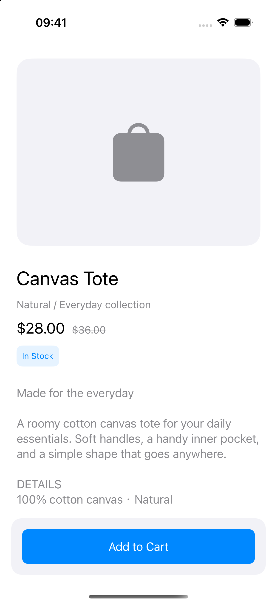
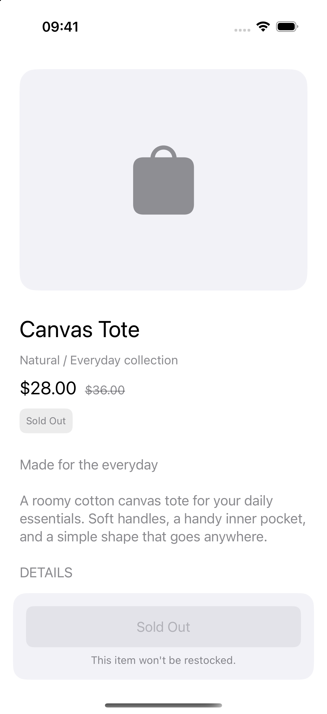
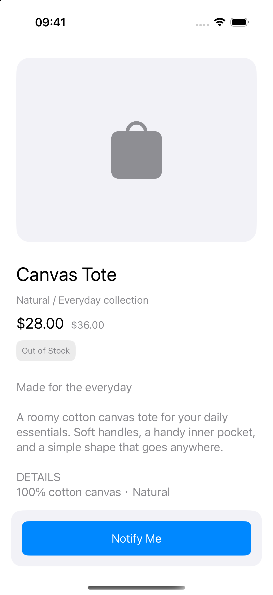
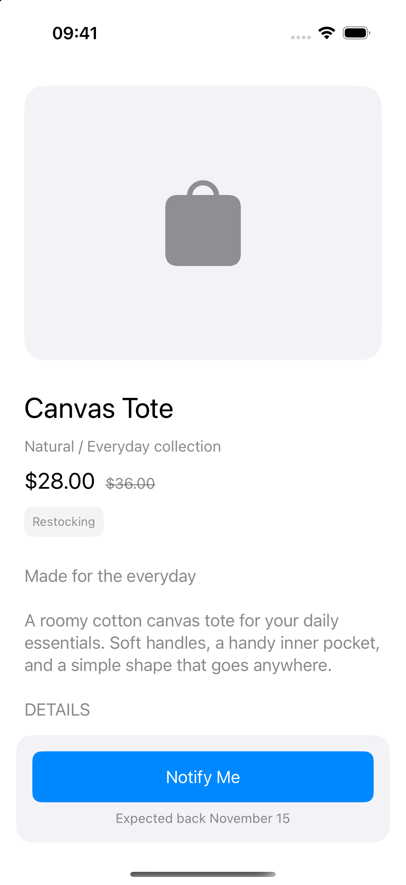
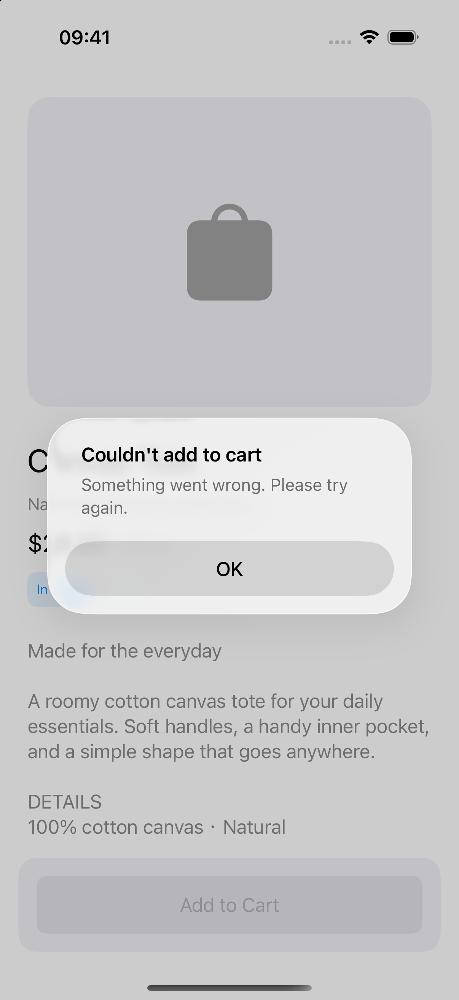

# Modular product detail demo

A fictional Canvas Tote page demonstrating three boundaries:

1. **Nested components:** parent `Content` values contain child `Content` values, passed down through `configure(with:)`.
2. **ViewModel:** an injected in-memory fixture supplies data; the ViewModel maps stock status into display content and reports changes through one callback.
3. **Package:** the app imports the local `ProductUI` library and uses its public API; child views and layout helpers stay hidden inside the package.

## Run

Run `xcodegen generate`, open `ModularDemo.xcodeproj`, select the `ModularDemo` scheme, and run on an iOS 17+ simulator. The project uses Swift 5 mode and Auto Layout, with no external dependencies or network requests.

Set launch arguments to `-scene inStock|soldOut|outOfStock|restocking|apiError` (choose one; default: `inStock`). Five separate full-screen previews are in `App/ProductDetailViewController.swift`; each component also has previews. The `apiError` scene automatically simulates one failed purchase after appearing and presents an alert.

## Screenshots

Screenshot destinations below are pending capture; no screenshots are included yet.

| State | Screenshot |
| --- | --- |
| In Stock |  |
| Sold Out |  |
| Out of Stock |  |
| Restocking |  |
| API Error |  |

This is a simplified example, not production code.
